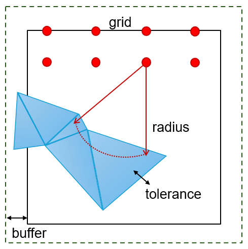
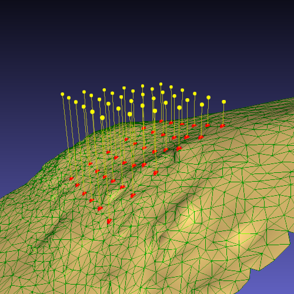

# grid-to-mesh

This tool projects a regular grid of points onto mesh surfaces along the grid normal direction. It works with both large and small triangles, as well as flat and nearly vertical ones.

The mesh format is `.ply` and the grid is provided as a `.xyz` file.

The algorithm identifies the triangles intersected by the grid normal and projects each point along the nadir direction.

It works with a single core or multiple cores processing. The number of cores can be specified in the configuration file.

## Installation

```bash
pip install git+https://github.com/mks-viii/grid-to-mesh.git
```

Requirements: Python `3.12` or later

## Usage

1. Put your mesh (`.ply`) and your grid (`.xyz`) in your folder.
2. Edit `config.json` with the file names and the parameters (see [Configuration](#configuration)).
3. Run the tool:

```bash
python -m grid-to-mesh.project_grid(config, mesh_file, points_file, output_dir, output_name)
```

The sofware will create automatically an 'output folder'. The projected points are saved in the output folder, with the suffix `_proj` added to the file name (e.g. `grid.xyz` becomes `grid_proj.xyz`).

## Configuration parameters

The tool computes the mesh bounding box and identifies the triangles contained in it. The parameters you can adjust in `config.json` are:

- **cores**: number of cores used for parallel processing.
- **buffer**: a buffer around the bounding box to ensure that triangles near the mesh boundaries are included..
- **radius**: It defines the maximum search distance for finding the nearest triangles to each point. Set the radius according to the distance between the point grid and the mesh surface.
- **tolerance**: `4e-1` for a high-resolution meshes, `10` for coarse meshes. If a point is projected onto the wrong side of the mesh, increase the tolerance.
- **closed_surface**: set to `true` for closed meshes (e.g. spheres, cylinders), which is very slow. Set to `false` for flat or smoothly curved surfaces, which is faster.

The following image describes the relationship among the config parameters.



### Decimation settings

> **Note:** the decimation tool is currently under development.

The following settings are used by the decimation tool. For the projection you can ignore them and keep the default values:

- **preserveboundary** (boolean): adjust for small circular meshes, e.g. a cylinder.
- **preservenormal** (boolean)
- **preservetopology** (boolean)

## Example
An example dataset is available in the `examples/` folder. Clone the example in your folder. To run the example use the run_example.py

```bash
python run_example.py
```
The result is a .xyz file containing the coordinates of the projected points.

In the following image, the points of a regular grid (yellow) are projected onto the mesh along the normal direction (yellow line). The projected points are shown as red dots.

*Note: the image is for visualization purposes only and was produced using external software.*





## Test
A test dataset is available in the `tests/` folder. To run the tests:

```bash
pytest -ls
```


## License

This project is licensed under the Apache License Version 2.0. See the [LICENSE](LICENSE) file for details.
